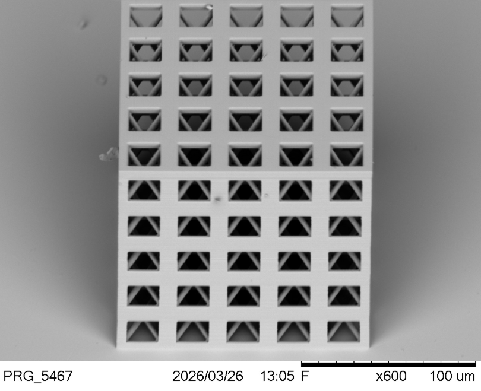
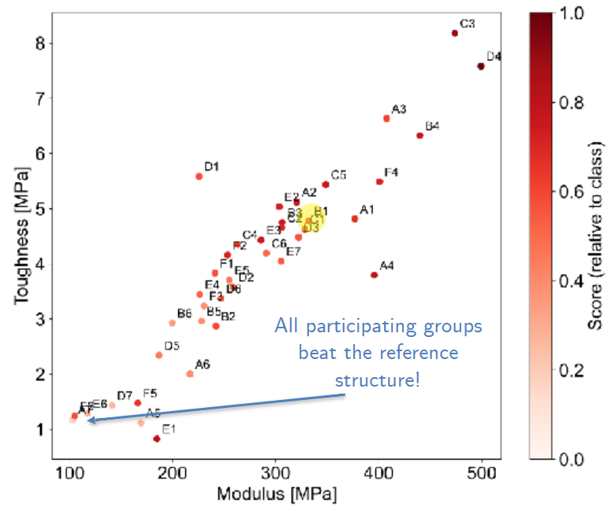
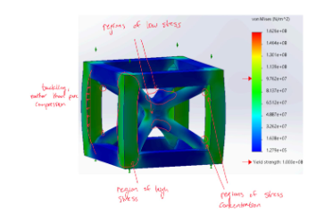
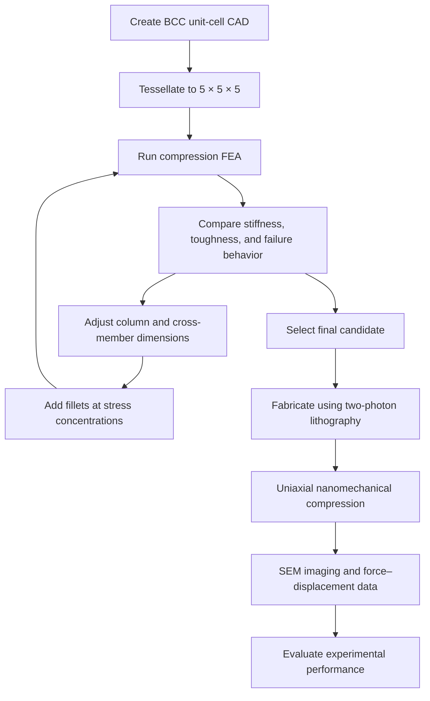

# IP-BRIX Metamaterial

**Design, finite-element iteration, and nanoscale compression testing of a body-centered-cubic metamaterial unit cell fabricated by two-photon lithography.**

<p align="center">
  
</p>

<p align="center">
  
  
  
  
</p>

**2.002 Team project** · MIT.nano

## Overview

This project developed a body-centered-cubic (BCC) mechanical metamaterial for a class competition focused on stiffness and toughness under uniaxial compression along a randomly selected cubic normal direction. The selected unit cell was tessellated into a \(5 \times 5 \times 5\) structure and fabricated from IP-BRIX using two-photon lithography at MIT.nano.

Because only one design could be fabricated and physical testing was expensive, finite-element analysis (FEA) was used to compare candidate geometries before committing to a final structure. Iterations focused on the trade-off between column dimensions and cross-member dimensions, as well as the use of fillets to reduce stress concentrations.

## Results

The team’s design ranked in the **top quartile for both stiffness and toughness** relative to the class results.

| Metric | Result |
|---|---:|
| Stiffness | TODO |
| Toughness | TODO |
| Relative density | TODO |
| Class percentile/rank — stiffness | TODO |
| Class percentile/rank — toughness | TODO |
| Tested compression direction | TODO |
| Peak force | TODO |
| Displacement at failure / end of test | TODO |

<p align="center">
  
</p>

### Main takeaways

- **Geometry was tuned using simulation.** Column and cross-member dimensions were iterated to improve stiffness while respecting the design constraints.
- **Fillets were added strategically.** The goal was to reduce local stress concentrations that could contribute to premature failure.
- **Simulation narrowed the design space.** Since fabricating every candidate was impractical, FEA informed the single design selected for fabrication and testing.

## Design and constraints

The unit cell uses a body-centered-cubic architecture and was repeated \(5 \times 5 \times 5\) times for fabrication and testing.

| Requirement / parameter | Value |
|---|---|
| Base material | IP-BRIX |
| Unit-cell architecture | Body-centered cubic (BCC) |
| Tessellation | \(5 \times 5 \times 5\) |
| Printed structure size | \(150\,\mu\text{m} \times 150\,\mu\text{m} \times 150\,\mu\text{m}\) |
| Maximum relative density | 25% |
| Minimum feature size | 15% of a side length |
| Fabrication method | Two-photon lithography |
| Fabrication facility | MIT.nano |
| Number of designs physically fabricated | One |
| Exact final relative density |  |
| Exact minimum feature size in the final CAD |  |

> **:** Confirm whether the 15% minimum-feature requirement was defined relative to the unit-cell side length or the full tessellated specimen, and add the official design requirements if available.

## Design iteration

The final design was based on a team member’s geometry that was very similar to the initial design developed by the author, with fillets added and dimensions further tuned.

The main iteration strategy was a manual, simulation-guided search:

1. Adjust column dimensions and cross-member dimensions.
2. Run FEA on each candidate to evaluate predicted compression behavior and performance.
3. Reduce cross-member dimensions and increase column side lengths to improve stiffness, continuing until the returns began to diminish.
4. Add fillets at selected transitions to reduce stress concentrations.
5. Select one candidate for fabrication, since each physical build was expensive.

The goal was not simply to maximize one geometric dimension, but to improve stiffness and toughness while remaining within the relative-density and minimum-feature constraints.

## Simulation and failure analysis

FEA was used to simulate compression, compare candidate designs, examine predicted failure behavior, and identify regions of elevated stress. These results guided geometry changes before fabrication.

<p align="center">
  
</p>

*Annotated stress-analysis image. Add the actual image at `images/stress_analysis.png`, or change this path to match the repository.*

The analysis considered:

- **Likely yielding regions:** TODO — identify the members or joints and the relevant stress criterion.
- **Potential buckling:** TODO — identify the columns or cross-members most susceptible to instability.
- **Stress concentrations:** Fillets were added at selected transitions to reduce local stress concentrations.
- **Stress concentration factor (SCF):** TODO — provide the definition, the nominal and peak stress values, and the resulting SCF if calculated.
- **Fast-fracture likelihood:** TODO — explain the conclusion and supporting evidence, including whether material fracture properties or only stress contours were available.

A stress contour can identify candidate hot spots, but it does not by itself establish a numerical SCF or prove that fast fracture will occur. Those conclusions depend on the stress definition, material properties, defect scale, and relevant failure criterion.

## Fabrication and experimental testing

The selected structure was fabricated from IP-BRIX at MIT.nano using two-photon lithography. The printed specimen was approximately \(150\,\mu\text{m}\) on each side.

Uniaxial nanomechanical compression was used to obtain force–displacement data. Scanning electron microscopy (SEM) was used to image the structure during compression and observe its deformation.

<p align="center">
  
</p>

### Compression video

[View the SEM compression video](images/C1_compression_vid.mp4)

The video records the metamaterial during compression. 


## Method

The workflow connected CAD iteration, simulation, fabrication, and physical characterization.



### Quantities

If stiffness was calculated as the slope of the force–displacement curve over a selected region, document the fitting interval and method:

$$
k = \frac{\Delta F}{\Delta \delta}
$$

where \(F\) is compressive force and \(\delta\) is displacement.

If toughness was calculated from work to failure normalized by specimen volume, document the exact integration bounds and normalization:

$$
U = \frac{1}{V}\int_{\delta_0}^{\delta_f} F(\delta)\,d\delta
$$

These expressions are templates only; confirm that they match the definitions used in the course and in the class comparison plot.

## Repository structure

```text
IP-Brix-Metamaterial/
├── images/
│   ├── C1_compression_vid.mp4
│   ├── metamaterial_results.png
│   ├── printed_model_view.png
│   └── stress_analysis.png       
└── README.md
```

## Reproducing the work

This repository currently documents the design and testing process. Full computational reproducibility depends on including the CAD model, FEA setup, material properties, boundary conditions, and experimental data.

1. Open the final CAD model in Fusion 360 or SolidWorks.
2. Confirm the unit-cell dimensions, \(5 \times 5 \times 5\) tessellation, minimum-feature constraint, and relative density.
3. Recreate the compression FEA using the original material model, contact assumptions, mesh, and boundary conditions.
4. Fabricate the selected design using the documented two-photon lithography settings.
5. Perform uniaxial nanomechanical compression and record force–displacement data.
6. Apply the documented stiffness and toughness calculations and compare results with the class dataset.

| Reproduction input | Status |
|---|---|
| Final CAD model | TODO |
| FEA project files and solver/version | TODO |
| Material model and properties | TODO |
| Mesh settings and convergence check | TODO |
| Boundary conditions and contact assumptions | TODO |
| Fabrication parameters | TODO |
| Raw force–displacement data | TODO |
| Analysis scripts / calculation workbook | TODO |
| Class comparison dataset | TODO |

## Limitations and future work

- Only one design was fabricated, so physical comparisons between candidate geometries were not possible.
- FEA predictions depend on the material model, mesh, boundary conditions, and representation of fabrication-scale imperfections.
- The specimen’s small size and fabrication process may introduce geometric variation that is not represented in an ideal CAD model.
- The exact numerical stiffness, toughness, relative density, and uncertainty are not yet documented here.
- The fast-fracture conclusion and numerical SCF require supporting calculations and material/failure data.

Potential next steps:

- Compare predicted and measured force–displacement curves.
- Add mesh-convergence evidence and document the material model.
- Quantify the effect of fillets and dimensional changes across candidate simulations.
- Document specimen-to-specimen variability if additional specimens become available.
- Include a quantitative failure analysis, with clearly defined SCF and fracture assumptions.


## Why I built this

> **TODO:** In your own voice, explain what interested you about designing and optimizing a mechanical metamaterial and what you wanted to learn from the project.

## What I learned

> **TODO:** Describe the most useful engineering lesson from the project. Possible themes include simulation-guided design under expensive fabrication constraints, stiffness–toughness trade-offs, and the difference between ideal FEA geometry and a physically tested microstructure.


## Contact

Carter Tucker — [LinkedIn](https://www.linkedin.com/in/carter-tucker-36083b32a/)
